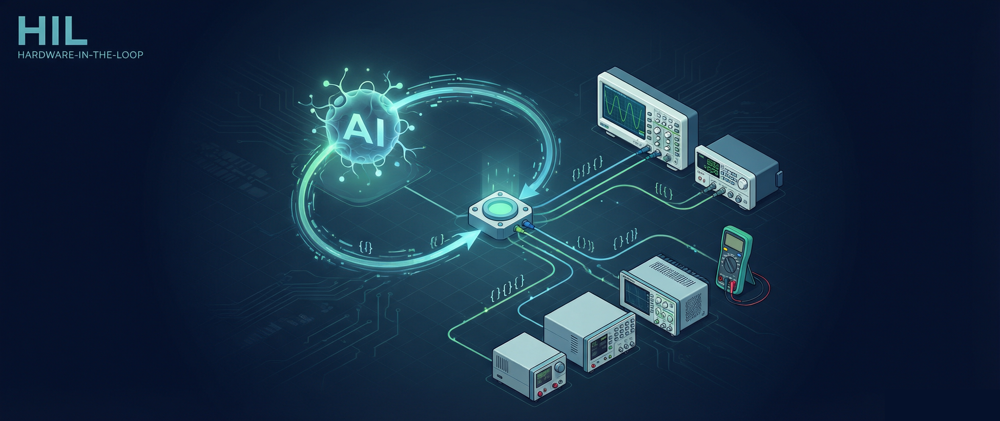

# HIL

### Hardware-in-the-Loop testing for lab instruments

**One safe, machine-readable interface to your bench.** Drive oscilloscopes,
source-measure units, power supplies, waveform generators, DMMs, e-fuses and even
non-SCPI tools like power profilers from Python, the CLI, or an AI agent — over LAN,
serial, or GPIB — with per-instrument safety enforced by default.

```bash
pip install git+https://github.com/adwuard/HIL.git     # active development — not on PyPI yet
```

> **Active development.** HIL is pre-release (v0.1.0) and is **not published to PyPI** yet —
> the `hil` name there belongs to an unrelated project, so HIL will publish as
> **`hil-harness`**. Install from source (above); the API may change between commits.

**725** instruments · **7** vendors · **~294k** SCPI commands · runs with **zero** hardware

---

## Why

Every instrument speaks SCPI — but every vendor speaks it *differently*. Different
commands, different connection methods, different ways to ruin a bench if you send
the wrong thing at the wrong time. Pointing a script (or an autonomous agent) at
real hardware means hand-wiring sockets, VISA resources, vendor dialects and safety
limits, every single time.

**HIL is the layer that ends that.** A uniform transport, a typed SCPI instrument, a
device registry with built-in safety policies, and a declarative test bench — all
surfaced as clean JSON that a human *or* a model can drive.

## What's inside

| Layer | Module | What it gives you |
|---|---|---|
| **Transport** | `hil.transports` | One byte-pipe to the instrument: raw **TCP** socket (stdlib, always on), **RS-232 serial**, and **VISA** (GPIB / USB / Ethernet). Optional backends install as extras, so the base stays light. |
| **Instrument** | `hil.instrument` | One `Instrument` interface — `write` / `query` / `execute`, the IEEE-488.2 commons, error-queue draining, `safe_execute`, and `capture()` for time-stamped sampling. `hil.scpi.ScpiInstrument` is the default implementation; non-SCPI devices plug in as drivers. |
| **Drivers** | `hil.drivers` | A pluggable registry that maps a device to its instrument implementation. Built-ins: `scpi`, `ppk2` (Nordic Power Profiler Kit II) and `logic` (logic analyzers, e.g. ALIENTEK ATK-Logic). Third parties register their own via the `hil.drivers` entry-point group — no fork required. |
| **Provision** | `hil.provision` | **On-demand setup of the optional device backends** HIL doesn't bundle (GPL or native builds). Declarative YAML *recipes* go detect → fetch/build → verify, driven by `hil setup`, surfaced in `hil doctor`, and triggered automatically by `connect()` under `HIL_AUTO_PROVISION`. Privileged installs and long compiles are gated behind `--yes`. |
| **Knowledge** | `hil.registry` | Declarative **YAML device profiles**: capabilities, command sets, connection examples, a `driver:` field, and a **safety policy** (block / allow / limits). Drop in your own dirs to extend it. |
| **Addressing** | `hil.addresses` | A single resolver for `tcp://host:5025`, `serial:///dev/ttyUSB0?baud=9600`, `visa://GPIB::24::INSTR`, `ppk2:///dev/cu.usbmodem01`, `logic://host:5555`, a bare `GPIB::24::INSTR`, or a registry **slug**. |
| **Telemetry** | `hil.telemetry` | Long-run **data logging + analytics**: append-only `Sample` records (timestamp, channel, value, units) to NDJSON/CSV, and `summarize()` for count, rate, mean/min/max/std, percentiles and energy (∫P·dt). Stdlib only. |
| **Artifacts** | `hil.artifacts` | **File-based captures** for high-volume devices (logic analyzers): a `CaptureArtifact` (path + metadata, never bulk bytes in memory) and a TTL-managed `ArtifactSpool` with retain/cleanup and NDJSON sidecars. Stdlib only. |
| **Errors** | `hil.errors` | A typed hierarchy where every message is *agent-actionable*: what failed, why, and the next step. |
| **Bench** | `hil.bench` | Declarative test **procedures** + a deterministic **simulator** + assertions + `capture`, `repeat` (loop), `logic` and `decode` steps + reports. Safety-first, and it runs with **zero hardware**. |
| **Interface** | `hil.cli` | An agent-first CLI — every command emits stable `--json` with meaningful exit codes, including `hil log` and `hil analyze`. |

## Built to be driven by AI

HIL isn't a GUI wrapper — it's a **Hardware-in-the-Loop harness**: the safe, structured surface an LLM
agent needs to operate real instruments autonomously.

- **Structured everything.** Every CLI command has `--json`; errors are typed and
  self-describing; `safe_execute` returns `{ok, response, errors, elapsed_s}` rather
  than throwing. The model gets parseable facts, not stack traces.
- **Safety by default.** Each device profile carries a policy. The bench *refuses to
  start* if a procedure could issue a blocked command, and re-checks every step
  against the policy before it reaches hardware — so an agent can explore freely
  without risking the bench.
- **A simulator to rehearse on.** A deterministic in-memory instrument — replies
  configured per procedure — lets agent-authored procedures run end-to-end with no
  hardware, so plans are validated before they touch a real device.
- **Plans as data.** A test is a versionable YAML procedure — auditable, reproducible,
  diffable — which is exactly how you want an agent's intent recorded.
- **MCP server (roadmap).** The same primitives, exposed as native model tools.

## Use it

HIL covers both halves of instrument work: **develop** — write code that talks to a
bench — and **test** — prove behaviour with repeatable, safety-checked procedures.

### Develop — one API over any instrument

```python
from hil import connect

smu = connect("keithley-2400")            # by registry slug -> safety policy attached
#   connect("tcp://192.168.1.5:5025")     # or by raw address

print(smu.idn())                          # 'KEITHLEY INSTRUMENTS,2400,...'
smu.write(":SOUR:VOLT 3.3")               # blocked if it violates the policy
print(smu.query(":MEAS:VOLT?"))
print(smu.safe_execute(":OUTP ON"))       # {'ok': True, 'errors': [], ...}
```

No hardware on hand? Develop against the in-memory instrument — same API, and it
records every command your code actually sent:

```python
from hil.bench import SimTransport
from hil.scpi import ScpiInstrument

sim = SimTransport(responses={":MEAS:VOLT?": "4.998"}, idn="KEITHLEY,2400,SN1,C33")
smu = ScpiInstrument(sim)
smu.write(":SOUR:VOLT 5.0")
print(smu.query(":MEAS:VOLT?"))   # 4.998
print(sim.writes)                 # [':SOUR:VOLT 5.0', ':MEAS:VOLT?']
```

Same thing from the shell (every command also takes `--json`):

```bash
hil idn tcp://192.168.1.5:5025            # identify
hil ask keithley-2400 ":MEAS:VOLT?"       # query (safety-checked)
hil exec keithley-2400 ":SOUR:VOLT 3.3"   # write (safety-checked)
hil devices list --json                   # the registry, machine-readable
```

### Test — repeatable procedures, hardware optional

```bash
hil bench init my-test                    # scaffold a procedure
hil bench validate my-test.yaml           # static checks, no instrument needed
hil bench run my-test.yaml --sim          # dry-run on the simulator
hil bench run my-test.yaml --address tcp://192.168.1.5:5025   # for real
```

```yaml
name: smu-output-accuracy
safety: { blocked: ["CAL:STR:UNPR"] }     # uncalibrate can never be issued
steps:
  - rst: {}
  - write: { command: ":SOUR:VOLT 5.0" }
  - write: { command: ":OUTP ON" }
  - query: { command: ":MEAS:VOLT?", save: vout }
  - assert: { kind: close, value: "{{ vout }}", expect: 5.0, tol: "1%" }
```

Run it with zero hardware — the simulator answers, and the safety policy still
applies exactly as it would on the bench:

```
$ hil bench run smu-output-accuracy.yaml --sim
PASS  SMU output accuracy  [sim: simulator]  device=keithley-2400
  10/10 steps passed
  measurements: vout=3.301 V, iout=0.052 A
```

## Beyond SCPI — third-party & custom instruments

Not everything on a bench speaks SCPI. Power profilers, on-chip debuggers, logic
analyzers and home-built USB/CDC power supplies use their own binary protocols and
vendor libraries. HIL keeps them all behind the **same `Instrument` interface**, so
the safety policy, bench, simulator, CLI and reports work unchanged.

A device profile selects its implementation with a `driver:` field (default `scpi`):

```yaml
slug: nordic-ppk2
driver: ppk2                     # routes connect() to hil.drivers.ppk2
connection_examples:
  - ppk2:///dev/cu.usbmodem01    # macOS · Linux /dev/ttyACM0 · Windows COM3
```

```python
from hil import connect
ppk2 = connect("ppk2:///dev/cu.usbmodem01", device_slug="nordic-ppk2")
ppk2.write(":SOUR:VOLT 3300")    # pseudo-SCPI facade -> native ppk2-api calls
samples = ppk2.capture(":MEAS:CURR?", seconds=5, units="A")
print(ppk2.query(":DIG:PORT?"))  # 8-bit word from the digital *input* channels
```

The bundled **PPK2** driver wraps Nordic's open-source
[`ppk2-api`](https://github.com/IRNAS/ppk2-api-python) behind a small pseudo-SCPI
facade (`:SOUR:VOLT`, `:OUTP`, `:CONF:MODE`, `:INIT:ACQ`, `:MEAS:CURR?`,
`:MEAS:POWer?`, plus the **8 digital input channels** via `:DIG<n>?` and
`:DIG:PORT?`). Because `ppk2-api` is **GPLv2** and HIL is **MIT**, the backend is an
*optional, user-installed* extra — never vendored into the core:

```bash
hil setup ppk2                    # on-demand: installs ppk2-api + libusb (see below)
pip install 'hil-harness[ppk2]'   # or directly; the ppk2 driver activates either way
```

> The PPK2's 8 digital channels are **inputs only** — a low-end logic analyzer for
> correlating code activity with power, not drivable outputs (any `:DIG...` write
> raises a clear error). Reading is optional on the backend: `ppk2-api` doesn't
> expose the digital channels yet, so the facade raises an actionable error and
> lights up automatically for any injected backend that implements `read_digital`.
> `capture("digital")` streams the 8-bit input word so you can line up current
> spikes with logic edges.

### Bring your own driver (OCD, logic analyzer, CDC power supply)

A driver is a factory `(address, device, timeout) -> Instrument`. Register it from
your own package via the `hil.drivers` entry-point group — HIL picks it up without a
fork or an edit:

```toml
# your package's pyproject.toml
[project.entry-points."hil.drivers"]
myocd = "my_pkg.hil_driver:ocd_driver"
```

```python
# my_pkg/hil_driver.py
from hil.instrument import BaseInstrument

class OcdInstrument(BaseInstrument):
    def __init__(self, addr, device=None, timeout=5.0):
        super().__init__(device)
        # open pyOCD / OpenOCD here
    def idn(self) -> str: ...
    def write(self, command) -> None: ...      # map pseudo-commands to your API
    def query(self, command, timeout=None) -> str: ...
    # BaseInstrument supplies execute/safe_execute/reset/opc/close and a
    # poll-based capture(); override capture() to stream native samples.

def ocd_driver(addr, device, timeout=5.0):
    return OcdInstrument(addr, device=device, timeout=timeout)
```

Then give the device a profile with `driver: myocd` and an address scheme, and it
inherits safety checks, bench steps, the simulator and `--json` reporting for free.

### Logic analyzers (ALIENTEK ATK-Logic)

A logic analyzer breaks the SCPI mould: captures are **huge** (MBs-GBs),
**timing-critical**, and only useful once **protocol-decoded**. So HIL splits it
into two processes:

- A **capture daemon** (GPLv3) owns the USB device, runs the real-time libusb
  stream and the `libsigrokdecode` decoders, and writes captures to disk. For the
  ALIENTEK ATK-Logic this is a headless `--server` build of the `atk-logic` Qt app.
- HIL is a **thin MIT client** (`driver: logic`, address `logic://host:5555`) that
  keeps one persistent JSON-RPC connection and receives captures as **artifacts**
  (a path + metadata), never as bulk bytes in memory. GPL stays out of HIL, and
  the timing-sensitive work stays out of the control loop.

```python
from hil import connect
la = connect("logic://127.0.0.1:5555", device_slug="alientek-atk-logic")
la.write(":CONF:CHAN 0,1"); la.write(":CONF:RATE 4000000")
la.write(":TRIG:CHAN 0"); la.write(":TRIG:EDGE R")
wave = la.run_capture(seconds=0.5, format="csv")   # -> CaptureArtifact (path + metadata)
dec  = la.decode("i2c")                            # -> decoded artifact (frames)
print(wave.path, wave.sample_count, dec.frames)
```

In a procedure, the `logic` and `decode` steps produce artifacts that land in a
TTL-managed **spool** (`$HIL_SPOOL_DIR` or `./.hil-spool`) and are recorded in the
run report; `save_as` binds the artifact path (`logic`) or frame count (`decode`)
for later steps and assertions:

```yaml
device: alientek-atk-logic
steps:
  - write: ":CONF:CHAN 0,1"
  - write: ":CONF:RATE 4000000"
  - logic:  {seconds: 0.5, format: csv, trigger: {channel: 0, edge: rising}, save_as: wave}
  - decode: {decoder: i2c, map: {scl: 0, sda: 1}, save_as: frames}
  - assert: {that: frames, op: gt, value: 0}
```

This runs with **zero hardware** on the built-in simulator (a synthetic capture
backend), so you can develop and CI the whole flow before a device is attached.
See `examples/bench/atk-logic-i2c-decode.yaml`, and `docs/logic-daemon-protocol.md`
for the daemon's JSON-RPC contract, cross-platform packaging and phasing.

## Optional device backends — `hil setup`

Most of HIL works the moment you install it. A few devices need an *optional*
backend that HIL deliberately does **not** bundle — either because it's
GPL-licensed (and must stay out of the MIT core) or because it's a large native
build. For those, HIL provisions the right thing **on demand**: install HIL, reach
for a device, and `hil setup` fetches, builds and verifies whatever it needs.

```bash
hil setup                         # what each backend needs, and whether it's ready
hil setup --list                  # list the provisioning recipes
hil setup ppk2                    # Nordic PPK2: pip install ppk2-api + libusb
hil setup alientek-atk-logic --yes   # ATK-Logic: toolchain + clone + native build
hil setup logic --dry-run         # print the whole plan, run nothing
hil doctor                        # env + backend availability, incl. provisioning
```

A **recipe** (declarative YAML) describes how to make one backend available:
`detect` probes (is it already usable?), `steps` to fetch/build it (`pip`,
`system`, `git`, `shell`), and `verify` probes to confirm the result. Recipes are
cross-platform and cross-compile aware (`HIL_CROSS_TARGET=android-arm64 …`), and you
can add or override one without touching HIL — drop a file in `third_party/recipes/`
or point `$HIL_RECIPES_DIR` at a folder.

**Safety first.** Provisioning can install packages and compile code, so it never
does anything surprising:

- **Privileged steps** (system installs that may need `sudo`) run **only** with
  `--yes`; otherwise they're reported as *gated*, with the exact command to run.
- **Heavy steps** (a long native compile) are gated too, so nothing stalls unattended.
- `--dry-run` prints every command without executing it.

**On demand, automatically.** Set `HIL_AUTO_PROVISION=1` and `hil.connect()` runs the
*safe* steps (pip installs, git clones) for a device whose backend is missing before
connecting — while privileged installs and heavy builds still wait for an explicit
`hil setup … --yes`. When a backend is missing, `connect()` and the driver errors
point you at the exact `hil setup <slug>` command.

It all lives in `third_party/`: `bootstrap.sh` (a thin `hil setup` wrapper for a
fresh clone), `recipes/` (your overrides), and `work/` (git-ignored clones and
builds). See [`third_party/README.md`](third_party/README.md) for the recipe format
and the environment variables.

## Data logging & analytics

Every `Instrument` can `capture(channel, seconds, interval, units)` and return
time-stamped `Sample` records — raw value plus timestamp plus channel, so nothing is
lost. Persist them and analyse later with the `hil.telemetry` module or the CLI.

```bash
# Log a channel to disk (append-only NDJSON; .csv also supported). --sim to rehearse.
hil log keithley-2400 --channel ":MEAS:CURR?" --seconds 300 --interval 0.5 \
        --units A --out run.ndjson

# Summarise any capture file: count, rate, mean/min/max/std, p50/p95/p99,
# and energy (Wh) for watt channels.
hil analyze run.ndjson --json
```

Inside a bench procedure, the `capture` step records stats into the report and can
feed an assertion or write a sidecar file:

```yaml
steps:
  - capture: {channel: ":MEAS:CURR?", seconds: 10, interval: 0.2, units: A, save_as: iavg}
  - assert:  {that: iavg, op: within, value: "0.040..0.060", message: "average draw in budget"}
```

`summarize()` is stdlib-only and computes energy by trapezoidal integration of power
channels (∫P·dt), so long soak runs yield both raw data and headline numbers.

### Long-running soaks with `repeat`

The `repeat` step loops a body of steps — so a procedure can toggle, sample and log
for hours without unrolling thousands of steps. `count` and any `seconds` accept
`${variables}`, so the same file runs a real soak on hardware and a scaled dry-run on
the simulator. Nested steps stream live progress; the report keeps a compact per-loop
summary while every `capture` still appends to its log file.

```yaml
variables: {period_s: 3, cycles: 600}          # 600 x (3 s on + 3 s off) = 1 hour
steps:
  - repeat:
      count: ${cycles}
      steps:
        - write: ":OUTP ON"
        - capture: {channel: ":MEAS:CURR?", seconds: ${period_s}, interval: 0.5, units: A, out: logs/on.ndjson}
        - write: ":OUTP OFF"
        - capture: {channel: ":MEAS:CURR?", seconds: ${period_s}, interval: 0.5, units: A, out: logs/off.ndjson}
```

See `examples/bench/ppk2-battery-soak.yaml` for a full hour-long PPK2 soak: it
toggles the source every 3 s, averages current, logs the source-voltage setpoint,
and reads a battery/charge flag off digital input **D0** (the PPK2's digital channels
are inputs only — wire the DUT's own output pin or a comparator into D0). Mark such
files `long_running: true` to keep them out of the fast bundled-example CI run.

## Knowledge base

HIL ships with a **reference library of 725 instruments across 7 vendors** — roughly
**294,000 SCPI commands** (83k queries · 211k setters) spanning 17 categories:
oscilloscopes, SMUs, power sources, meters, RF, DAQ, electronic loads and e-fuses.
Five profiles are hand-curated with safety policies and load by default; the full
corpus is a versioned dataset under `data/` that you can add to the registry.

### Every instrument, by brand and type

Model numbers only — grouped by manufacturer, then instrument type. The six
hand-curated profiles load by default with safety policies:

| Slug | Instrument | Type | Driver |
|---|---|---|---|
| `keithley-2400` | Keithley 2400 | SourceMeter (SMU) | `scpi` |
| `rigol-dho1072` | Rigol DHO1072 | Oscilloscope | `scpi` |
| `keysight-ac6801b` | Keysight AC6801B | AC power source | `scpi` |
| `ea-el9000b` | EA EL9000B | DC power supply | `scpi` |
| `nordic-ppk2` | Nordic Power Profiler Kit II | Power profiler (non-SCPI) | `ppk2` |
| `alientek-atk-logic` | ALIENTEK ATK-Logic | Logic analyzer (non-SCPI, daemon) | `logic` |

The rest of the corpus lives in the versioned dataset under `data/`.

#### Keysight (279)

**power supply** (226)

|  |  |  |  |  |  |
|---|---|---|---|---|---|
| AC6801B | AC6802B | AC6803B | AC6804B | AC6903H | AC6903L |
| AC6906H | AC6906L | AC6912H | AC6912L | AC6918H | AC6918L |
| DP5721A | DP5722A | DP5723A | DP5724A | DP5726A | DP5728A |
| DP5730A | DP5731A | DP5733A | DP5736A | DP5741AH | DP5741AL |
| DP5741AS | DP5742AH | DP5742AL | DP5742AS | DP5743AH | DP5743AL |
| DP5743AS | DP5744AH | DP5744AL | DP5744AS | DP5746AH | DP5746AL |
| DP5746AS | DP5748AH | DP5748AL | DP5748AS | DP5750AH | DP5750AL |
| DP5750AS | DP5751AH | DP5751AL | DP5751AS | DP5753AH | DP5753AL |
| DP5753AS | DP5756AH | DP5756AL | DP5756AS | DP5761AH | DP5761AL |
| DP5762AH | DP5762AL | DP5763AH | DP5763AL | DP5764AH | DP5764AL |
| DP5765AH | DP5765AL | DP5766AH | DP5766AL | DP5768AH | DP5768AL |
| DP5770AH | DP5770AL | DP5771AH | DP5771AL | DP5772AH | DP5772AL |
| DP5773AH | DP5773AL | DP5774AH | DP5774AL | DP5775AH | DP5775AL |
| DP5776AH | DP5776AL | DP5782AH | DP5782AL | DP5783AH | DP5783AL |
| DP5784AH | DP5784AL | DP5786AH | DP5786AL | DP5788AH | DP5788AL |
| DP5790AH | DP5790AL | DP5791AH | DP5791AL | DP5792AH | DP5792AL |
| DP5793AH | DP5793AL | DP5796AH | DP5796AL | DP5797AH | DP5797AL |
| DP5799AH | DP5799AL | E36102B | E36103B | E36104B | E36105B |
| E36106B | E36154A | E36155A | E36231A | E36232A | E36233A |
| E36234A | E36311A | E36312A | E36313A | E3632A | E3646A |
| E3647A | E3648A | E3649A | EDU36311A | N5741A | N5742A |
| N5743A | N5744A | N5745A | N5746A | N5747A | N5748A |
| N5749A | N5750A | N5751A | N5752A | N5761A | N5762A |
| N5763A | N5764A | N5765A | N5766A | N5767A | N5768A |
| N5769A | N5770A | N5771A | N5772A | N6700C | N6701C |
| N6702C | N6950A | N6951A | N6952A | N6953A | N6954A |
| N6970A | N6971A | N6972A | N6973A | N6974A | N6976A |
| N6977A | N7950A | N7951A | N7952A | N7953A | N7954A |
| N7970A | N7971A | N7972A | N7973A | N7974A | N7976A |
| N7977A | N8731A | N8732A | N8733A | N8734A | N8735A |
| N8736A | N8737A | N8738A | N8739A | N8740A | N8741A |
| N8742A | N8754A | N8755A | N8756A | N8757A | N8758A |
| N8759A | N8760A | N8761A | N8762A | N8920A | N8921A |
| N8923A | N8924A | N8925A | N8926A | N8928A | N8929A |
| N8930A | N8931A | N8932A | N8934A | N8935A | N8937A |
| N8937APV | N8940A | N8941A | N8943A | N8944A | N8945A |
| N8946A | N8948A | N8949A | N8950A | N8951A | N8952A |
| N8954A | N8955A | N8957A | N8957APV |  |  |

**oscilloscope** (38)

|  |  |  |  |  |  |
|---|---|---|---|---|---|
| DSOX1202A | DSOX1202G | DSOX1204A | DSOX1204G | DSOX2002A | DSOX2004A |
| DSOX2012A | DSOX2014A | DSOX2022A | DSOX2024A | DSOX4022G | DSOX4024G |
| DSOX4032G | DSOX4034G | DSOX4052G | DSOX4054G | DSOX4104G | DSOX4154G |
| DSOX6002A | DSOX6004A | EDUX1052A | EDUX1052G | MSOX2002A | MSOX2004A |
| MSOX2012A | MSOX2014A | MSOX2022A | MSOX2024A | MSOX4022G | MSOX4024G |
| MSOX4032G | MSOX4034G | MSOX4052G | MSOX4054G | MSOX4104G | MSOX4154G |
| MSOX6002A | MSOX6004A |  |  |  |  |

**source measure unit** (5)

|  |  |  |  |  |
|---|---|---|---|---|
| M9601A | M9602A | M9603A | M9614A | M9615A |

**photovoltaic array simulator** (4)

|  |  |  |  |
|---|---|---|---|
| PV8921A | PV8922A | PV8931A | PV8932A |

**electronic load** (3)

|  |  |  |
|---|---|---|
| EL33133A | EL34143A | EL34243A |

**power analyzer** (2)

|  |  |
|---|---|
| N6705C | N6715C |

**battery emulator** (1)

|  |
|---|
| E36731A |

#### Rigol (211)

**oscilloscope** (97)

|  |  |  |  |  |  |
|---|---|---|---|---|---|
| DHO1072 | DHO1074 | DHO1102 | DHO1104 | DHO1202 | DHO1204 |
| DHO4204 | DHO4404 | DHO4804 | DHO5054 | DHO5058 | DHO5104 |
| DHO5108 | DHO802 | DHO804 | DHO812 | DHO814 | DHO914 |
| DHO914S | DHO924 | DHO924S | DS1052D | DS1052E | DS1054Z |
| DS1074B | DS1074Z-PLUS | DS1074Z-S-PLUS | DS1102D | DS1102E | DS1104B |
| DS1104Z-PLUS | DS1104Z-S-PLUS | DS1202Z-E | DS1204B | DS2072A | DS2072A-S |
| DS2102A | DS2102A-S | DS2202A | DS2202A-S | DS2302A | DS2302A-S |
| DS7014 | DS7024 | DS70304 | DS7034 | DS70504 | DS7054 |
| DS8034R | DS80604 | DS80804 | DS81004 | DS8104R | DS81304 |
| DS8204R | DS9202 | DS9204 | DS9404 | DS9604 | MHO2024 |
| MHO2034 | MHO5054 | MHO5056 | MHO5104 | MHO5106 | MHO934 |
| MHO954 | MHO984 | MSO1074Z | MSO1074Z-S | MSO1104Z | MSO1104Z-S |
| MSO2072A | MSO2072A-S | MSO2102A | MSO2102A-S | MSO2202A | MSO2202A-S |
| MSO2302A | MSO2302A-S | MSO5072 | MSO5074 | MSO5102 | MSO5104 |
| MSO5204 | MSO5354 | MSO7014 | MSO7024 | MSO7034 | MSO7054 |
| MSO8064 | MSO8074A | MSO8104 | MSO8154A | MSO8204 | MSO8304A |
| MSO9402 |  |  |  |  |  |

**function generator** (31)

|  |  |  |  |  |  |
|---|---|---|---|---|---|
| DG1032Z | DG1062Z | DG5071 | DG5072 | DG5101 | DG5102 |
| DG5251 | DG5252 | DG5252PRO | DG5254PRO | DG5258PRO | DG5351 |
| DG5352 | DG5352PRO | DG5354PRO | DG5358PRO | DG5502PRO | DG5504PRO |
| DG5508PRO | DG6052 | DG6054 | DG6102 | DG6104 | DG70002 |
| DG70004 | DG821PRO | DG822PRO | DG852PRO | DG902PRO | DG912PRO |
| DG922PRO |  |  |  |  |  |

**spectrum analyzer** (23)

|  |  |  |  |  |  |
|---|---|---|---|---|---|
| DSA705 | DSA710 | DSA815 | DSA815-TG | DSA832 | DSA832-TG |
| DSA875 | DSA875-TG | RSA3015E | RSA3015E-TG | RSA3030 | RSA3030-TG |
| RSA3030E | RSA3030E-TG | RSA3045 | RSA3045-TG | RSA5032 | RSA5032-TG |
| RSA5065 | RSA5065-TG | RSA6085 | RSA6140 | RSA6265 |  |

**network analyzer** (21)

|  |  |  |  |  |  |
|---|---|---|---|---|---|
| DNA5042 | DNA5082 | DNA5142 | DNA5202 | DNA5262 | DNA6082 |
| DNA6082R | DNA6084 | DNA6084R | DNA6142 | DNA6142R | DNA6144 |
| DNA6144R | DNA6202 | DNA6202R | DNA6204 | DNA6204R | DNA6262 |
| DNA6262R | DNA6264 | DNA6264R |  |  |  |

**power supply** (18)

|  |  |  |  |  |  |
|---|---|---|---|---|---|
| DP2031 | DP711 | DP712 | DP811 | DP811A | DP813 |
| DP813A | DP821 | DP821A | DP822 | DP822A | DP831 |
| DP831A | DP832 | DP832A | DP932A | DP932E | DP932U |

**function/arbitrary waveform generator** (12)

|  |  |  |  |  |  |
|---|---|---|---|---|---|
| DG2052 | DG2072 | DG2102 | DG811 | DG812 | DG821 |
| DG822 | DG831 | DG832 | DG952 | DG972 | DG992 |

**electronic load** (4)

|  |  |  |  |
|---|---|---|---|
| DL3021 | DL3021A | DL3031 | DL3031A |

**multimeter** (4)

|  |  |  |  |
|---|---|---|---|
| DM3058 | DM3058E | DM858 | DM858E |

**data acquisition/switch system** (1)

|  |
|---|
| M300 |

#### Keithley (85)

**source measure unit** (39)

|  |  |  |  |  |  |
|---|---|---|---|---|---|
| 2400 | 2400-C | 2400-LV | 2401 | 2410 | 2410-C |
| 2420 | 2420-C | 2425 | 2425-C | 2430 | 2430-C |
| 2440 | 2440-C | 2450 | 2450-NFP | 2450-NFP-RACK | 2460 |
| 2460-NFP | 2460-NFP-RACK | 2461 | 2461-NFP | 2461-NFP-RACK | 2470 |
| 2510 | 2510-AT | 2520 | 2601B | 2601B-PULSE | 2602B |
| 2604B | 2611B | 2612B | 2614B | 2634B | 2635B |
| 2636B | 2651A | 2657A |  |  |  |

**power supply** (36)

|  |  |  |  |  |  |
|---|---|---|---|---|---|
| 2200-20-5 | 2200-30-5 | 2200-32-3 | 2200-60-2 | 2200-72-1 | 2220-30-1 |
| 2220G-30-1 | 2220GJ-30-1 | 2220J-30-1 | 2230-30-1 | 2230G-30-1 | 2230GJ-30-1 |
| 2230J-30-1 | 2231A-30-3 | 2260B-250-13 | 2260B-250-4 | 2260B-250-9 | 2260B-30-108 |
| 2260B-30-36 | 2260B-30-72 | 2260B-80-13 | 2260B-80-27 | 2260B-80-40 | 2260B-800-1 |
| 2260B-800-2 | 2260B-800-4 | 2280S-32-6 | 2280S-60-3 | 2281S-20-6 | 2290-10 |
| 2290-5 | 2290E-5 | 2290J-5 | 2303 | 2303-PJ | 2303B |

**battery/charger simulator** (6)

|  |  |  |  |  |  |
|---|---|---|---|---|---|
| 2302 | 2302-PJ | 2306 | 2306-PJ | 2306-VS | 2308 |

**electronic load** (4)

|  |  |  |  |
|---|---|---|---|
| 2380-120-60 | 2380-500-15 | 2380J-120-60 | 2380J-500-15 |

#### Tektronix (84)

**arbitrary waveform generator** (40)

|  |  |  |  |  |  |
|---|---|---|---|---|---|
| AFG3011 | AFG3011C | AFG3021 | AFG3021B | AFG3021C | AFG3022B |
| AFG3022C | AFG3051C | AFG3052C | AFG3101 | AFG3101C | AFG3102 |
| AFG3102C | AFG3151C | AFG3152C | AFG3251 | AFG3251C | AFG3252 |
| AFG3252C | AWG4162 | AWG5002B | AWG5002C | AWG5004B | AWG5012B |
| AWG5012C | AWG5014B | AWG5014C | AWG5202 | AWG5204 | AWG5208 |
| AWG70001A | AWG70001B | AWG70002A | AWG70002B | AWG7061B | AWG7062B |
| AWG7082C | AWG7121B | AWG7122B | AWG7122C |  |  |

**oscilloscope** (22)

|  |  |  |  |  |  |
|---|---|---|---|---|---|
| LPD64 | MDO32 | MDO34 | MSO44B | MSO46B | MSO54B |
| MSO56B | MSO58B | MSO58LP | MSO64B | MSO66B | MSO68B |
| TBS1052C | TBS1072C | TBS1102C | TBS1202C | TBS2072B | TBS2074B |
| TBS2102B | TBS2104B | TBS2202B | TBS2204B |  |  |

**arbitrary function generator** (10)

|  |  |  |  |  |  |
|---|---|---|---|---|---|
| AFG31021 | AFG31022 | AFG31051 | AFG31052 | AFG31101 | AFG31102 |
| AFG31151 | AFG31152 | AFG31251 | AFG31252 |  |  |

**power supply** (7)

|  |  |  |  |  |  |
|---|---|---|---|---|---|
| PS2520G | PS2521G | PWS4205 | PWS4305 | PWS4323 | PWS4602 |
| PWS4721 |  |  |  |  |  |

**source measure unit** (3)

|  |  |  |
|---|---|---|
| MP5103 | MPSU50-2ST | MSMU60-2 |

**function generator** (2)

|  |  |
|---|---|
| AFG1022 | AFG1062 |

#### EA Elektro-Automatik (29)

**power supply** (29)

|  |  |  |  |  |  |
|---|---|---|---|---|---|
| EA-BT-20000 | EA-BT-20000-TRIPLE | EA-EL9000-2Q | EA-EL9000B | EA-EL9000DT | EA-EL9000HP |
| EA-EL9000T | EA-ELM5000 | EA-ELR-10000 | EA-ELR5000 | EA-ELR9000 | EA-ELR9000HP |
| EA-PS-10000 | EA-PS9000-1U | EA-PS9000-2U | EA-PS9000-3U | EA-PS9000-T | EA-PSB-10000 |
| EA-PSBE-10000 | EA-PSI-10000 | EA-PSI9000-15U-24U | EA-PSI9000-2U | EA-PSI9000-3U | EA-PSI9000-DT |
| EA-PSI9000-T | EA-PSI9000-WR | EA-PU-10000 | EA-PUB-10000 | EA-PUL-10000 |  |

#### Rohde & Schwarz (22)

**power supply** (14)

|  |  |  |  |  |  |
|---|---|---|---|---|---|
| HMP2020 | HMP2030 | HMP4030 | HMP4040 | NGC101 | NGC101-G |
| NGC102 | NGC102-G | NGC103 | NGC103-G | NGL201 | NGL202 |
| NGM201 | NGM202 |  |  |  |  |

**oscilloscope** (8)

|  |  |  |  |  |  |
|---|---|---|---|---|---|
| MXO34 | MXO38 | RTA4004 | RTB2002 | RTB2004 | RTC1002 |
| RTM3002 | RTM3004 |  |  |  |  |

#### B&K Precision (15)

**oscilloscope** (6)

|  |  |  |  |  |  |
|---|---|---|---|---|---|
| 2565B | 2565B-MSO | 2567B | 2567B-MSO | 2569B | 2569B-MSO |

**power supply** (5)

|  |  |  |  |  |
|---|---|---|---|---|
| 1696B | 1697B | 1698B | BCS6401 | BCS6402 |

**multimeter** (2)

|  |  |
|---|---|
| 2831E | 5491B |

**signal generator** (2)

|  |  |
|---|---|
| 4088 | 4089 |

## Install

HIL is in **active development** and is not on PyPI yet — the `hil` name there is an
unrelated project. Install from source:

```bash
pip install git+https://github.com/adwuard/HIL.git      # latest main
# or clone and install editable for development:
git clone https://github.com/adwuard/HIL.git && cd HIL
pip install -e '.[dev]'                                  # editable + test deps
```

Extras: `.[serial]` (RS-232), `.[visa]` (GPIB / VISA / USB), `.[ppk2]` (Nordic PPK2
backend, GPLv2), `.[all]`, `.[dev]`. Python 3.10+. Core requires only PyYAML.

## Status

**v0.1.0** — transports, SCPI layer, a pluggable instrument/driver registry (with
non-SCPI PPK2 and logic-analyzer drivers), telemetry (logging + analytics), bench,
on-demand backend provisioning (`hil setup`), and CLI are live and tested. The MCP
server and a PyPI release as `hil-harness` are next.
MIT licensed.
